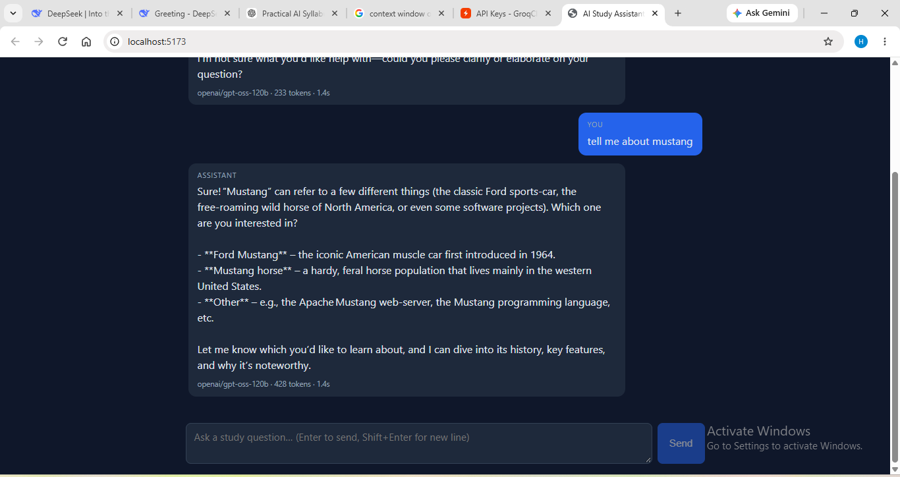

# AI Study Assistant — LLM Chatbot

A clean, portfolio-ready chatbot that demonstrates **practical LLM engineering** —
not just "send a prompt to an API". React + TypeScript frontend, FastAPI backend,
OpenRouter-compatible LLM layer with streaming, retries, rate-limit handling,
model fallback, token tracking, and tests.

## Overview

This project shows that the developer understands what production LLM features
actually require:

- LLM API integration behind a small provider-abstraction layer
- Prompt engineering via a dedicated, editable system prompt
- Conversation history (in-memory sessions, trimmed context window)
- Token-by-token **streaming** (SSE) with progressive UI rendering
- Token usage tracking (when the provider returns it)
- Request **timeouts** on every external call
- **Retries with exponential backoff** (transient errors only)
- **Rate-limit handling** — provider 429s (with `Retry-After`) *and* a
  separate app-level per-IP limiter
- Configurable **fallback model** for provider-side failures
- Safe error mapping (no keys, stack traces, or paths leak to the browser)
- Structured logging (no secrets), request validation, CORS, tests

## Demo



Live chat with streaming replies, Markdown rendering (bold, lists, code blocks),
and per-reply model + token + latency info.

## Features

- Modern chat UI: user/assistant bubbles, streaming caret, latency + token meta
- Markdown rendering for assistant replies (bold, lists, code blocks, tables)
- Enter-to-send, loading state, error display, clear/reset conversation
- `POST /api/chat` (JSON) and `POST /api/chat/stream` (SSE)
- `POST /api/chat/reset`, `GET /api/health`, `GET /api/config` (non-secret)
- 35 automated tests, all mocked — no API key or network needed

## Architecture

```
Browser (React)
    │  POST /api/chat  ·  POST /api/chat/stream (SSE)  ·  POST /api/chat/reset
    ▼
FastAPI backend  (owns the API key — browser never sees it)
    │  validation · app rate limit · session store · safe error mapping
    ▼
ChatService  (history: system + prior messages + current message, trimmed)
    │  timeout · retry+backoff · 429 handling · fallback · usage logging
    ▼
OpenRouterClient  (only file that knows OpenRouter HTTP/SSE details)
    │  primary model ──(retryable failure)──▶ fallback model
    ▼
OpenRouter → primary model → (fallback model if needed)
```

## Tech Stack

Frontend: React + TypeScript + Vite, plain modern CSS
Backend: FastAPI + Python + httpx + Pydantic
LLM: OpenRouter (`/chat/completions`, OpenAI-compatible, SSE streaming)

## How It Works

1. User sends a message → frontend `POST`s to `/api/chat/stream`.
2. Backend validates input, checks the per-IP rate limit, loads the session.
3. `ChatService` builds the prompt: **system prompt + trimmed history +
   current message** (max 20 prior messages by default).
4. `OpenRouterClient` calls the primary model with a timeout, retrying
   transient failures (network, 5xx, 429, timeout) with exponential backoff.
5. If the primary fails for a provider-side reason, the fallback model is tried.
6. Tokens stream back as SSE events; the UI appends them live. Usage stats
   (when returned) arrive with the final event.
7. On success the turn is appended to session history; failures never pollute it.

## Setup

Prerequisites: Python 3.11+, Node.js 18+.

```bash
git clone <your-repo-url>
cd ai-study-assistant

# Backend
cd backend
python -m venv .venv
# Windows: .venv\Scripts\activate | macOS/Linux: source .venv/bin/activate
pip install -r requirements.txt
copy .env.example .env        # Windows
# cp .env.example .env        # macOS/Linux
# ... then edit .env and set OPENROUTER_API_KEY

# Frontend (new terminal)
cd frontend
npm install
```

## Environment Variables

`backend/.env.example`:

```env
# Copy this file to `.env` and fill in your key. Never commit `.env`.
OPENROUTER_API_KEY=
OPENROUTER_MODEL=openai/gpt-4o-mini
OPENROUTER_FALLBACK_MODEL=meta-llama/llama-3.1-8b-instruct
```

| Variable | Default | Purpose |
|---|---|---|
| `OPENROUTER_API_KEY` | (empty) | Backend-only secret. App returns a safe error if missing. |
| `OPENROUTER_MODEL` | `openai/gpt-4o-mini` | Primary model. |
| `OPENROUTER_FALLBACK_MODEL` | `meta-llama/llama-3.1-8b-instruct` | Backup model for provider-side failures. |
| `OPENROUTER_TIMEOUT_SECONDS` | `30.0` | Per-request timeout (also in `config.py`). |
| `MAX_RETRIES` / `MAX_HISTORY_MESSAGES` / `MAX_INPUT_CHARS` / `MAX_OUTPUT_TOKENS` | `3 / 20 / 4000 / 1024` | Reliability + context controls (env-overridable via `config.py`). |
| `APP_RATE_LIMIT_PER_MINUTE` | `30` | Per-IP app-level limit. |

## Running

```bash
# Terminal 1 — backend (from backend/)
uvicorn app.main:app --reload --port 8000

# Terminal 2 — frontend (from frontend/)
npm run dev
```

Open http://localhost:5173. The Vite dev proxy forwards `/api/*` to the
backend. For a single-process demo, run `npm run build` in `frontend/`, then
start the backend — it serves `frontend/dist` at `/` automatically.

### Using Groq (or another OpenAI-compatible provider)

The backend speaks standard `/chat/completions` + SSE, so only `backend/.env`
changes — no code changes:

```env
OPENROUTER_API_KEY=gsk_...
OPENROUTER_BASE_URL=https://api.groq.com/openai/v1
OPENROUTER_MODEL=openai/gpt-oss-120b
OPENROUTER_FALLBACK_MODEL=openai/gpt-oss-20b
```

Check which model IDs your key can access via `GET {base_url}/models`
(verified live with Groq: chat, streaming, usage tracking, and reset all work).

## Testing

```bash
cd backend
python -m pytest tests -q
```

35 tests, all with mocked LLM calls — no API key, no network. Covers:
validation, history trimming/isolation, retry/no-retry rules, 429 handling,
fallback (and when *not* to fall back), timeout, error taxonomy, API routes,
app rate limiting, and secret-leak checks.

Frontend type-check + build:

```bash
cd frontend
npm run build   # runs tsc + vite build
```

## Reliability

- **Timeout** — every provider call has connect + read timeouts
  (`config.openrouter_timeout_seconds`); hangs become `LLMTimeoutError`.
- **Retry** — transient failures only (network, 5xx, 429, timeout), up to
  `max_retries` with exponential backoff (`1s → 2s → 4s…`). Auth, invalid
  requests, and context-length errors are never retried.
- **Rate limiting** — provider 429s respect the `Retry-After` header; a
  separate in-memory sliding-window limiter caps each IP at
  `app_rate_limit_per_minute` requests/min.
- **Fallback** — primary → fallback only for provider-side failures
  (5xx/network/timeout/429/empty reply). Bad keys and bad requests fail fast.
- **Error handling** — every failure maps to a safe `{error, code}` message;
  logs keep diagnostics (model, latency, retries) without secrets.

## Security

- API key lives only in `backend/.env` (git-ignored); `GET /api/config`
  exposes model names, never the key.
- Input size limits, per-IP rate limiting, dev-scoped CORS.
- This is a **portfolio/learning project**, not a hardened production system:
  sessions are in-memory, there is no auth, and the limiter is per-process.

## Limitations

- In-memory history: sessions vanish on restart; single-process only.
- No RAG, embeddings, tool calling, agents, auth, or persistence (by design).
- Token counts come from the provider; when absent the UI simply omits them.
- Live chat/streaming was verified with mocked tests; end-to-end replies
  require a valid `OPENROUTER_API_KEY`.

## Future Improvements

RAG over study notes, embeddings + vector store, tool calling (e.g. quiz
generator), persistent memory (SQLite/Postgres), multi-turn evaluation harness,
prompt-version tracking, basic auth for shared deployments.
